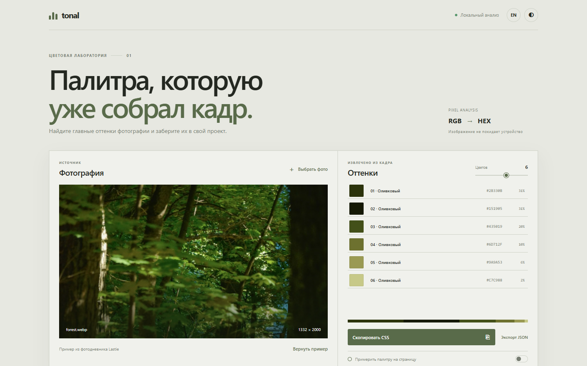

# Tonal — палитра из фотографии / Photo Palette

[Русский](#русский) · [English](#english)

## Русский

Tonal извлекает основные цвета фотографии прямо в браузере. Исходное изображение остаётся на устройстве.



### Возможности

- Загрузка фотографии или перетаскивание файла в рабочую область.
- Выбор от 3 до 8 оттенков и просмотр их доли в кадре.
- Копирование отдельного HEX-кода, всей палитры в виде CSS-переменных или экспорт в JSON.
- Применение палитры ко всей цветовой схеме страницы с учётом темы.
- Русский и английский языки, автоматическая, светлая и тёмная темы.
- Пример лесной фотографии уже включён в проект.

Изображение уменьшается для быстрой обработки через Canvas. Цвета группируются локально; сторонние сервисы и модели не используются.

### Запуск локально

Откройте `index.html` или запустите сервер в папке проекта:

```sh
python -m http.server 8000
```

Откройте <http://localhost:8000>. Сборка и установка зависимостей не требуются.

### SEO и география

Страница содержит описание, Open Graph и структурированные данные `WebApplication`. В метаданных указано место создания проекта — Уфа, Башкортостан; инструмент работает в браузере независимо от местоположения пользователя.

---

## English

Tonal extracts a small set of leading colors from a photograph in your browser. The source image stays on your device.


### Features

- Choose an image or drop it into the workspace.
- Select 3 to 8 colors and inspect their share in the photograph.
- Copy one HEX value, copy all colors as CSS variables, or download JSON.
- Apply the palette across the interface while preserving contrast in both themes.
- Switch between Russian and English, automatic, light and dark themes.
- Start with the bundled forest photograph.

The image is reduced for faster Canvas analysis. Colors are grouped locally; no external service or model is used.

### Run locally

Live site: <https://thelastie.github.io/tonal/>. GitHub Actions republishes it whenever changes reach `main`.

Open `index.html`, or start a server from the project folder:

```sh
python -m http.server 8000
```

Visit <http://localhost:8000>. No build step or dependencies are required.

### SEO and geography

The page includes a description, Open Graph metadata and `WebApplication` structured data. Regional metadata identifies Ufa, Bashkortostan as the project's place of creation; the browser tool itself works independently of the user's location.
